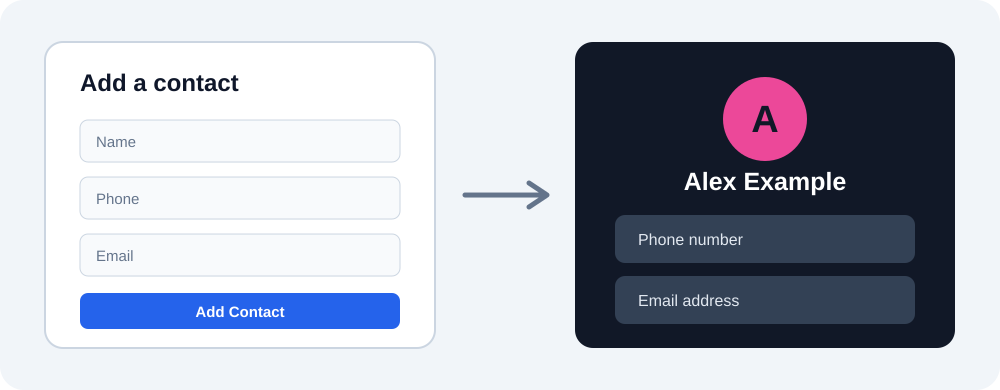
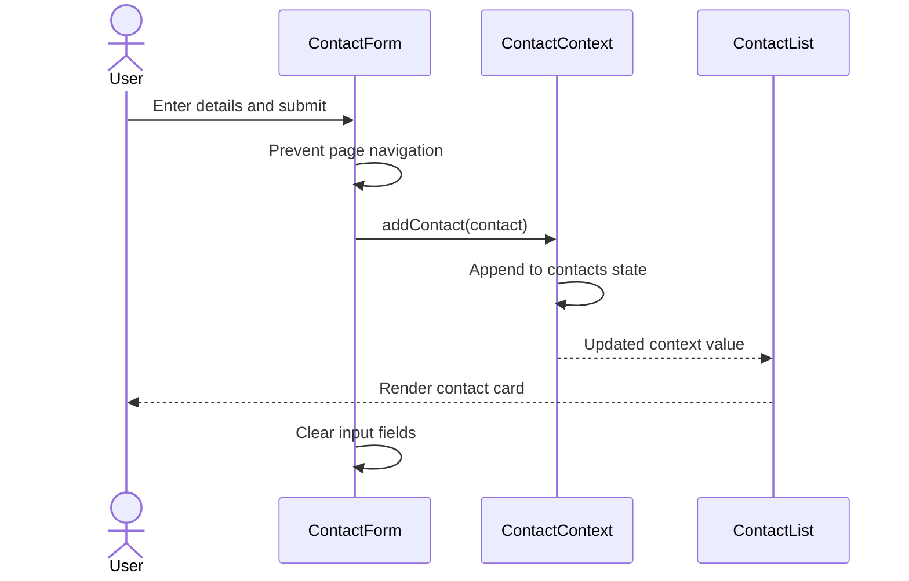

<div align="center">


# 📇 Contact Card App

**A lightweight React contact manager for adding and viewing personal contact cards.**

[](https://react.dev/)
[](https://create-react-app.dev/)
[](LICENSE)
[](docs/README.md)

</div>

---

## ✨ About the project

Contact Card App is a small single-page React application that collects a contact's **name, phone number, and email address**, then renders the submitted information as a card. React Context shares the in-memory contact collection between the form and list.

It demonstrates component composition, controlled inputs, hooks, context, and list rendering.

> **Current implementation boundary:** contacts exist only in React state and are lost on refresh. There is no backend, database, authentication, routing, contact editing/deletion, or persistent storage in the inspected app.

## 🖼️ Project preview

The repository contains original SVG concept artwork, not screenshots of a running application.



## ✅ Implemented features

| Capability | Current behavior |
|---|---|
| Add contact | Accepts name, phone, and email |
| Required fields | Browser-level required validation |
| Shared state | React Context provider |
| Contact list | Renders submitted contact cards |
| Avatar | Displays uppercase first character |
| Responsive styles | Includes a 600px media query |
| Call, Message, Video | Buttons are visual labels only, with no handlers |

## 🧰 Technology stack

- React 19.1 and React DOM
- Create React App via react-scripts 5.0.1
- React Context and hooks
- CSS
- npm and package-lock.json
- Testing Library dependencies (no application test files currently present)

## 🏗️ Architecture

```mermaid
flowchart TD
  Browser[Browser] --> Entry[src/index.js]
  Entry --> App[src/App.js]
  App --> Provider[ContactProvider]
  Provider --> Form[ContactForm]
  Provider --> List[ContactList]
  Form -->|addContact(contact)| State[(React Context state)]
  State -->|contacts| List
  List --> Cards[Contact cards]
```

| File | Responsibility |
|---|---|
| `src/index.js` | Creates React root and renders Strict Mode |
| `src/App.js` | Composes provider, heading, form, and list |
| `src/ContactContext.js` | Owns contacts array and `addContact` |
| `src/ContactForm.js` | Controls name, phone, and email inputs |
| `src/ContactList.js` | Reads context and renders cards |
| `src/App.css` | Global page, container, form, button styling |
| `src/ContactCard.css` | Card, avatar, action row, information panel |
| `public/index.html` | HTML shell and React mount point |

## 🔁 Add-contact workflow



## 🚀 Getting started

### Prerequisites
- Node.js and npm
- Git
- A modern browser

### Install and run

```bash
git clone https://github.com/Brajesh31/Contact-Card-App.git
cd Contact-Card-App
npm ci
npm start
```

Open [http://localhost:3000](http://localhost:3000).

### Commands

| Command | Purpose |
|---|---|
| `npm start` | Starts development server |
| `npm test -- --watchAll=false` | Runs the CRA test runner once |
| `npm run build` | Creates optimized output in `build/` |
| `npm run eject` | Ejects CRA configuration, an irreversible operation |

## 🗂️ Project structure

```text
.
├── .github/                 # Issue forms, PR template, workflows
├── docs/                    # Project and engineering documentation
│   ├── architecture/
│   ├── assets/
│   ├── security/
│   ├── templates/
│   └── website/
├── public/
│   └── index.html
├── scripts/
├── src/
│   ├── App.css
│   ├── App.js
│   ├── ContactCard.css
│   ├── ContactContext.js
│   ├── ContactForm.js
│   ├── ContactList.js
│   └── index.js
├── .editorconfig
├── .gitignore
├── CHANGELOG.md
├── CODE_OF_CONDUCT.md
├── CONTRIBUTING.md
├── LICENSE
├── README.md
├── ROADMAP.md
├── SECURITY.md
└── SUPPORT.md
```

This logical tree excludes the currently tracked generated `node_modules/` directory. It has not been deleted by this documentation update.

## 🌐 Website documentation

The app currently renders one view at `/`, with a heading, contact form, and saved-contact list. There is no client-side router or set of separate pages. See [the complete website documentation](docs/website/README.md) for the page inventory, component interactions, UI states, responsive styling, and navigation journey.

## 🧪 Quality checks

```bash
node scripts/validate-docs.js
npm run build
npm test -- --watchAll=false
```

The inspected source tree contains no application test files, so test coverage is not claimed. The documentation validator checks local Markdown links and required files.

## 🔐 Security and privacy

Contact details entered in the current app are held in browser memory and are not sent to a server by the inspected source code. There is no authentication or authorization layer. Use synthetic data in screenshots and issues. See [SECURITY.md](SECURITY.md) and [privacy documentation](docs/privacy.md).

## ♿ Accessibility

Native inputs and browser required validation are used. The inspected form currently uses placeholders rather than explicit visible labels. No WCAG audit has been completed. See [accessibility guidance](docs/accessibility.md).

## 🧭 Roadmap

Potential improvements, not implemented features:
- [ ] Add stable contact IDs and edit/delete controls.
- [ ] Add tests for context, form validation, and cards.
- [ ] Add persistence after defining a privacy model.
- [ ] Wire communication actions to appropriate browser protocols.
- [ ] Improve form labels and accessibility.
- [ ] Capture real screenshots of the running app.

See [ROADMAP.md](ROADMAP.md).

## 🤝 Contributing

Read [CONTRIBUTING.md](CONTRIBUTING.md), use the issue templates, and provide validation evidence for changes.

## 📚 Documentation index

Browse **[docs/README.md](docs/README.md)** for the full documentation map, including architecture, setup, website, security, testing, deployment, troubleshooting, and templates.

## 📄 License

MIT. See [LICENSE](LICENSE).

<div align="center">Made with ❤️ using React</div>

Last updated: 2026-11-17 23:46 UTC
