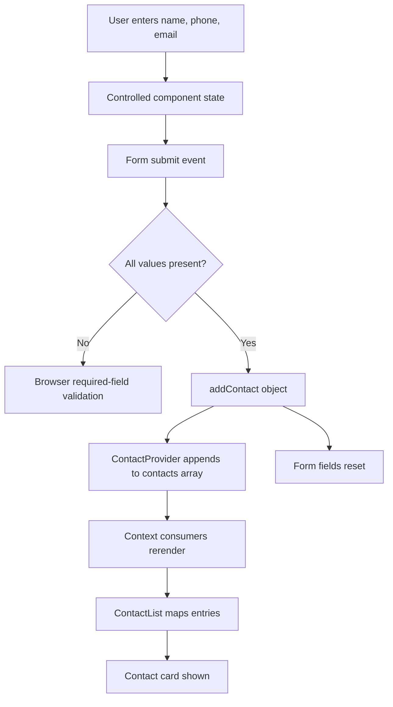

# 🔄 Data flow

The form performs a truthiness check for all three values and relies on native required validation. No data leaves the React component tree in the inspected code. A refresh resets the collection.
