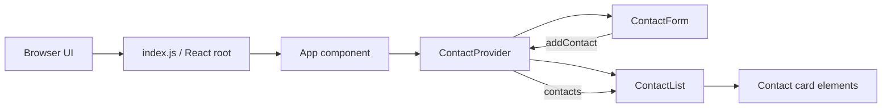

# 🏗️ System design

## Context
A browser-hosted React application composed of a top-level view, shared state provider, entry form, and list.

## Logical architecture

## Quality attributes and constraints
- **Simplicity:** few components and a small state surface.
- **Availability:** the UI is static client-side code after assets load.
- **Durability:** none for contacts, because state is in memory.
- **Security:** no server-side trust boundary is implemented.
- **Scalability:** not evaluated; this is a small learning app.

## Not present
There are no API gateways, service containers, persistence stores, queues, or identity providers to diagram.
